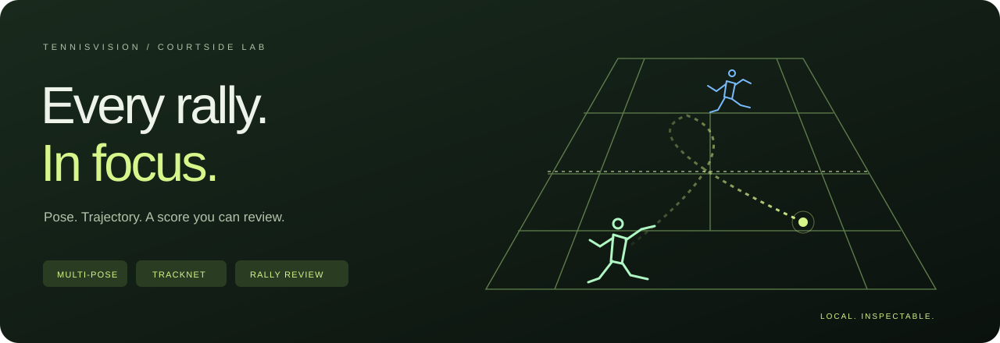
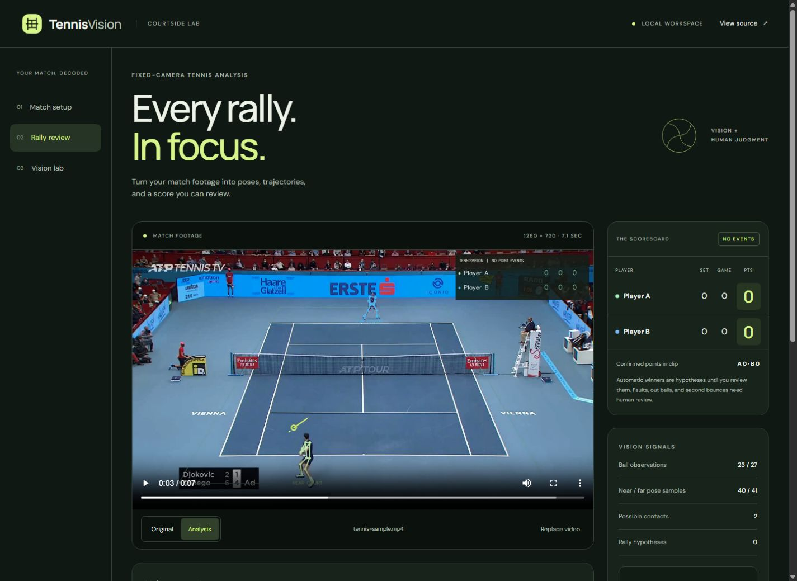

<p align="center">


</p>

<p align="center"><b>A computer-vision workspace for fixed-camera singles tennis.</b><br>Upload a clip. Calibrate the court. Inspect poses and the ball trajectory.<br>Review proposed point endings and export your annotated match.</p>

<p align="center"><a href="#run-locally">Run locally</a> · <a href="docs/METHOD.md">Vision method</a> · <a href="docs/EVALUATION.md">Evaluation</a> · <a href="docs/ARCHITECTURE.md">Architecture</a></p>



## From footage to a reviewable score

| Watch | Inspect | Make the call | Export |
| --- | --- | --- | --- |
| Upload MP4, MOV, AVI, or WebM | 33-landmark player poses | Replay a proposed rally ending | Annotated H.264 MP4 |
| Calibrate four singles baseline corners | TrackNet ball observations and trails | Confirm, correct, reject, or add a point | Point timeline CSV |
| Set player names and starting score | Near/far ground-plane traces | Separate estimated and confirmed scores | Analysis ZIP and frame labels |

**Automatic winners are experimental hypotheses, not reliable officiating.** The system combines ball-flight reversals with nearby arm landmarks to propose contacts. A tracking loss after an exchange can suggest a rally ending, but cannot establish line calls, service faults, net touches, or second bounces. Every proposed point remains pending until reviewed. Unresolved winners do not change the score. A clip ending or camera cut does not award a point.

## Run locally

Python **3.11 or 3.12** is recommended. No API key is needed.

```bash
git clone https://github.com/Mahsatajik/TennisVision.git
cd TennisVision
python -m venv .venv
# macOS / Linux
source .venv/bin/activate
# Windows PowerShell: .venv\Scripts\Activate.ps1

python -m pip install -e .
python -m pip install torch --index-url https://download.pytorch.org/whl/cpu
tennisvision models --tracknet
tennisvision serve
```

Open **http://127.0.0.1:7862**. For CUDA, install the appropriate PyTorch build from its official instructions instead of the CPU command. For the classical baseline, skip PyTorch and run `tennisvision models` without `--tracknet`. The UI enables installed engines. The baseline is useful for ablation but substantially less robust to small, blurred balls.

1. **Upload** a continuous clip, up to 512 MB and five minutes. Inputs are normalized to H.264 at 30 fps, up to 1280 pixels wide, so frame labels and video share a stable timeline.
2. **Calibrate** far-left, far-right, near-right, and near-left singles baseline corners. Numeric fields are available as a keyboard alternative to clicking.
3. **Configure** the near-side player, starting score, and detector. Use separate segments for changes of camera or ends. Near/far are spatial slots, not persistent player identities.
4. **Analyze.** TrackNet is much slower on CPU. Four samples per second is a starting point, not a guarantee of adequate temporal resolution for fast shots.
5. **Review.** Add missed points at the playhead, correct winners, and reject false events. Save to regenerate the video and reports without rerunning neural inference.

Inference runs locally; models are downloaded separately. The server binds to `127.0.0.1`. Uploads and jobs remain in `outputs/matches/` until removed. This is a single-worker local workspace, not an authenticated multi-user hosting service. The UI uses external fonts with system fallbacks.

## The computer-vision core

- **Court-aware poses:** calibrated crops enlarge the distant athlete; landmark visibility and court-side gates reject many spectators. Missing observations remain missing.
- **Interchangeable detectors:** a color/motion baseline and pretrained three-frame TrackNet share the same association and export contracts.
- **Temporal association:** short motion prediction rejects large jumps. Long gaps are not invented or interpolated in exported ball data.
- **Pose–trajectory fusion:** a ball-depth reversal must coincide with nearby arm landmarks to become a contact cue. Alternating contacts and tracking loss generate uncertain rally hypotheses.
- **Measurable outputs:** raw model predictions, reviewer decisions, normalized ball observations, pose landmarks, and run configuration are exported separately. Human labels support localization and event evaluation.

This project integrates pretrained models and implements an inspectable analysis/review pipeline. It does **not** claim a newly trained model, a novel research method, or validated autonomous scoring accuracy. The evaluation workflow makes improvements measurable.

## Scoring semantics

The independent engine supports standard advantage games, deuce, sets, best-of-three/five matches, and win-by-two tiebreaks at 6–6, with a seven- or ten-point target. Tournament-specific formats, no-ad games, and deciding match tiebreaks replacing a set are not implemented.

- **Estimated:** pending hypotheses with a proposed winner plus confirmed points.
- **Confirmed:** reviewer-confirmed points only.
- **Rejected / unresolved:** excluded from both scores.

Enter the score at the start of the clip; video cannot reconstruct points played before recording. The detector can miss aces, faults, or exchanges where a player is occluded. The UI exposes uncertainty rather than fabricating a final result.

## Reproduce an analysis

```bash
# Optional public smoke-test clip; downloaded locally, not bundled
python scripts/fetch_sample.py
tennisvision analyze data/tennis-sample.mp4 \
  --config configs/sample.json --output outputs/baseline
```

The sample configuration matches only that view. It starts from love-all to exercise the application, not to reproduce the broadcast's match score. For TrackNet, copy the configuration, change `"detector"` to `"tracknet"`, and use a separate output directory. The sample is a short broadcast court-view segment; its existing scoreboard is ignored. It is not an amateur fixed-camera benchmark. See [data provenance](docs/DATA.md).

```text
outputs/matches/<match-id>/
  source.mp4        Normalized analysis input
  annotated.mp4     Poses, ball trail, and event-driven scoreboard
  predictions.json Original model hypotheses
  events.json       Reviewer decisions, including rejected events
  scores.json       Estimated/confirmed scores and timelines
  ball.csv          Frame, time, visibility, normalized x/y, evidence index
  poses.jsonl       Actual landmark observations
  motion.csv        Approximate ground-plane player traces
  config.json       Calibration, detector, sampling, and scoring settings
  analysis.json     Input hash, runtime, coverage, cuts, and contacts
  labels.json       Human ball labels, when created
  points.csv        Point-event timeline
  report.zip        Analysis artifacts, excluding video and weights
```

## Evaluate rather than guess

Use **Vision lab** to label visible and hidden balls. Compare detectors on the same held-out frames, normalized input resolution, calibration, and sampling schedule.

```bash
tennisvision evaluate --predictions outputs/baseline/ball.csv \
  --labels data/labels.json --width 1280 --height 720 --tolerance 12

tennisvision evaluate-events --predictions outputs/baseline/predictions.json \
  --truth data/point-ground-truth.json --tolerance 1.0
```

Metrics include pixel error, localization precision/recall/F1, label coverage, event F1, timing error, and winner accuracy. **Detection coverage is not accuracy.** Reviewer-corrected events must not be used as predictions in a benchmark. See the [evaluation protocol](docs/EVALUATION.md).

## Development

```bash
python -m pip install -e '.[dev]'
ruff check src tests
pytest -q
python -m build
```

The [ready-to-install workflow](docs/ci-checks.yml) checks Python 3.11 and 3.12 without model downloads. Copy it to `.github/workflows/checks.yml` to enable GitHub Actions; the publishing credential did not grant workflow access. Hosted CI has not run. Tests cover scoring boundaries, geometry, temporal association, rally uncertainty, metric matching, uploads, range requests, review validation, and labels. Real-model execution is documented separately in [validation notes](docs/VALIDATION.md).

## Credits

Created by **Mahsa Tajik**. Credits remain with the model and data authors:

- [MediaPipe Pose Landmarker](https://ai.google.dev/edge/mediapipe/solutions/vision/pose_landmarker): pose model and runtime.
- [TrackNet, Huang et al., AVSS 2019](https://arxiv.org/abs/1907.03698): temporal localization architecture. Checkpoint key layout follows [yastrebksv/TrackNet](https://github.com/yastrebksv/TrackNet).
- [Versioned tennis checkpoint](https://huggingface.co/vishnushenoy09/tracknet-v1-tennis): publisher-labeled MIT weights, downloaded separately and checksum-verified.
- [2026 Rules of Tennis](https://www.world.tennis/media/7221/2026-rules-of-tennis-english.pdf): standard scoring rules.

See [third-party provenance](docs/DATA.md) for model revisions and media attribution.
