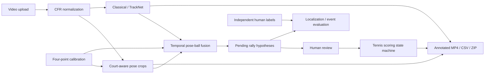

# Architecture

`models.py` defines configuration/events/labels. `geometry.py` handles homography. `pose.py` gates MediaPipe observations. `ball.py` exposes interchangeable detector and association implementations; `tracknet.py` contains the compatible architecture. `rallies.py` produces uncertain hypotheses. `scoring.py` knows tennis rules but no video details. `pipeline.py`, `render.py`, and `evaluate.py` handle exports, rendering, and independent metrics.

FastAPI serves packaged HTML/CSS/JavaScript and a small upload/job API. One worker owns inference. UUID job directories, atomic status records, cancellation, allowlisted artifacts, and range requests support isolated uploads and video seeking. Filenames are metadata, never destination paths. Limits are 512 MB and five minutes per clip.

CLI and UI share the same pipeline. The client does not reimplement scoring rules: a preview endpoint computes both timelines. Review reuses `poses.mp4`; raw hypotheses remain separate from edited events. A new analysis of a completed clip creates a new job, preserving previous predictions and reviews while reusing the normalized video and labels. Jobs persist on disk. Interrupted jobs are reported after server restart rather than silently presented as complete. API documentation is at `/docs`.

This local single-user service has no deployment authentication or automatic retention scheduler.
